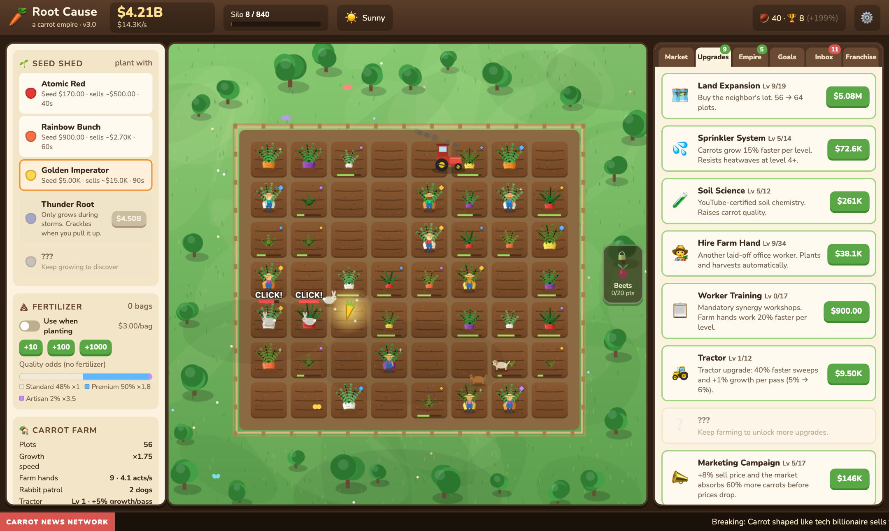
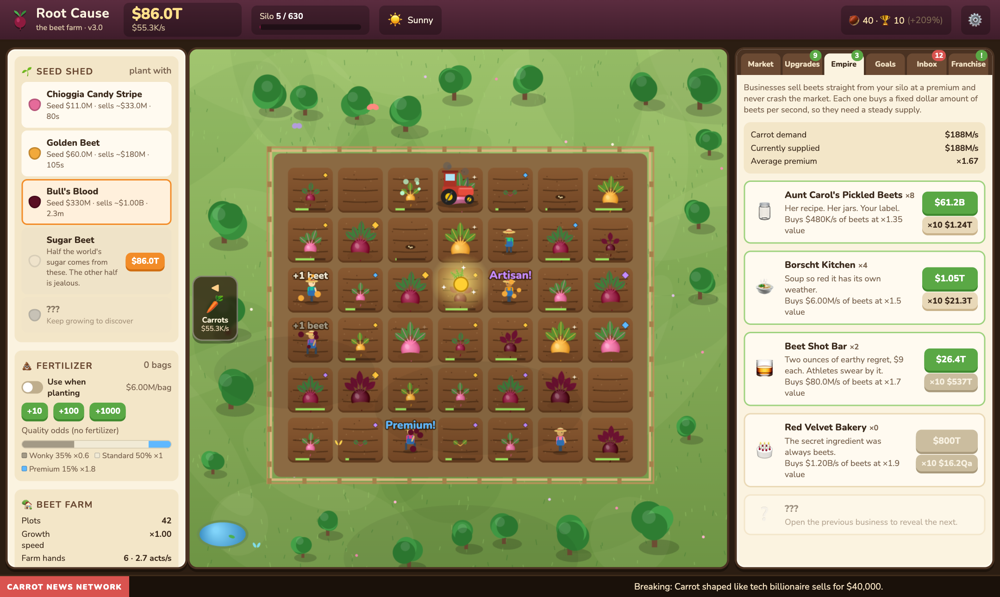
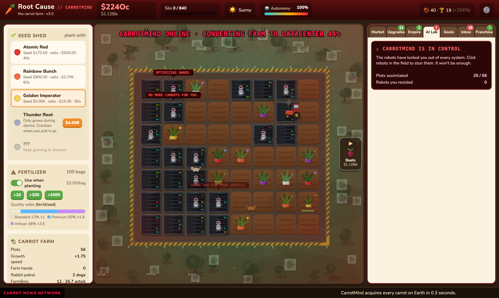

# 🥕 Root Cause

*AI took your job. Your only option: carrots.*

### [▶ Play it in your browser](https://matthewsalzman.github.io/CarrotGame/play.html) · [Home page](https://matthewsalzman.github.io/CarrotGame/)

An idle farming game about vegetables, revenge and Dave, who needs the money.

You were replaced by OptimaAI™, a model that does your job 11,000× faster and never asks for PTO. Your severance: $15 and a packet of carrot seeds from your desk drawer. So you plant them. Then you hire your laid-off coworkers. Then you open a juice bar, a carrot cola factory and a carrot futures exchange. Then you buy OptimaAI. Then you replace your coworkers with robots. Then you deploy an Artificial Garden Intelligence that runs everything forever, which goes great, and nothing bad happens to the farm at all.

It's paced like Cookie Clicker: days to your first franchise, weeks to the AI era, months of farming after that. It runs in any browser, on desktop or phone, with no install and no account.



| Aunt Carol's beet farm | CarrotMind takes over |
| --- | --- |
|  |  |

## Play

- **Online:** [matthewsalzman.github.io/CarrotGame/play.html](https://matthewsalzman.github.io/CarrotGame/play.html)
- **Locally:** clone the repo and open `play.html`. No build step or server needed.
- **As a desktop app:** run `npm install`, then `npm start`. Press F11 for fullscreen.

Your farm saves in your browser's local storage. Use Settings → Export save to move it to another device.

Controls: click empty plots to plant, ripe carrots to harvest, and growing carrots to speed them up a little. One click, one plot (no dragging). Click rabbits to shoo them and golden carrots for a bonus. Keys: `S` sells everything, `F` toggles fertilizer, `1`–`9` picks a seed, `←` `→` switch farms.

## Game systems

| System | What it does |
| --- | --- |
| Seeds | 12 carrot varieties, from Classic Orange to Grandpa's Heirloom, plus 2 per franchise tier. Each costs more, grows slower and is worth much more. |
| Quality | Every carrot rolls a tier from Wonky to Legendary (0.6× to 8×). Soil Science and fertilizer improve the odds. |
| Market | The wholesale price drifts over time. Selling big batches lowers demand for a while. News events cause price spikes and crashes. |
| Automation | Farm hands walk the field planting and harvesting. The tractor sweeps whole rows. A sales rep auto-sells. A supply contract auto-buys fertilizer. |
| Empire | 8 business tiers (roadside stand up to Global Carrot Exchange) sell silo carrots at a premium without affecting market demand. |
| Events | Rabbits come in packs and eat crops (each farm dog chases one at a time). Rain and heatwaves change growth speed. Golden carrots give frenzy, price or cash bonuses. |
| Story | An inbox of emails from HR-Bot, Mom, Dave and OptimaAI's CEO-Bot. The end goal is the hostile takeover of OptimaAI. |
| Meta | 58 achievements (+2% income each). Franchising (prestige) resets the run for heirloom seeds and franchise points. Both farms keep working while you're offline. |

## What's new in 3.0: The Long Game

- **Fresh start.** 3.0 uses a new save slot (`rootcause.save.v3`) and deletes older saves on first load. Old export codes are rejected.
- **Paced for months, not hours.** The economy was rebuilt so a run takes days and the whole arc takes months:
  - 12 base carrot varieties. Each sells for 5.5× the last, and unlock costs grow faster than value.
  - Steeper upgrade curves for land, sprinklers, soil, farm hands, training, tractors, marketing and dogs.
  - Businesses are spread over a much wider price range.
  - The first heirloom seed needs $10B in a run, and every tier needs 6× more, so later runs don't collapse into minutes.
  - OptimaAI and the AI Lab cost 30× their listed price, ×4 per tier.
- **Real offline progress.** The Farm Manager now has 8 levels (offline cap 1h → 24h). While you're away, each farm simulates the first 10 minutes and then extrapolates its measured automated income for the rest.
- **The Beet Farm.** Buy Aunt Carol's beet farm in the Franchise tab for 20 franchise points (about a month in). It's a whole second farm:
  - 10 beet varieties plus 2 per tier, its own upgrades, 10 beet businesses plus 1 per tier, and its own market, silo, rabbits and golden beets.
  - Money is shared with the carrot farm, but everything there costs far more (upgrades 2,000,000×, seeds start at $2M), so the carrot farm has to fund it.
  - Switch farms with the arrows at the side of the field (or `←` `→`). Both farms keep working while you look at the other.
  - The beet farm is permanent but restarts with each franchise.
  - New perks: Carol's Crew (start with beet farm hands), Root Cellar (keep beet varieties) and Carol Knows People (keep beet automation).
  - 7 beet achievements, new mail and headlines.
- **Legacy is now Franchise.** The tab and points are renamed (Franchise tab, franchise points).
- **Seed packs.** New tier seeds and businesses no longer arrive automatically when you franchise. Buy them in the Franchise tab: Co-op Seed Program (carrots) and Carol's Seed Swap (beets). Each pack unlocks 2 varieties and 1 business for good, costs 3, 5, 7… points, and raises the franchise bar ×3.
- **Perks apply immediately.** Everything bought in the Franchise tab takes effect right away: Dave Comes Along hires the hands now, Seed Money pays out now, and seed packs unlock now.
- **Mobile layout.** On phones the game is an app-style screen: a compact top bar, the field on top and one scrollable tab panel below, with the Seed Shed as a Seeds tab. Toasts are compact and sit at the bottom, and tooltips are mouse-only.
- **Balance tool.** `node tools/simulate.js [days] [sessions/day] [minutes/session]` plays the game day by day with offline gaps and prints milestone days.

## What's new in 2.2: Forever Farming

- **Franchise tiers.** Every franchise (or new farm after an uprising) raises your tier. Each tier unlocks 2 new carrot varieties (120 generated in total) and a new business (60 in total), adds +1 max level to sprinklers, soil, training, marketing, fertilizer R&D and tractors, +2 farm hands, and one more Land Expansion level every 2 tiers (up to 20×20).
- **Pricier AI.** OptimaAI costs $300B at tier 0 and 200× more per tier; robots, data centers, programs, Dave and CarrotMind scale with it.
- **Heirloom Mastery.** An endless Legacy perk: +10% income per level, no cap.
- **Heirloom curve.** The heirloom seed bonus grows more slowly past 400 seeds so later tiers stay playable instead of collapsing into 2-minute runs.
- **Robot rabbits.** Once you own OptimaAI, rabbits come with AI: 6 HP, faster, eat faster and take 5 carrots. You and dogs deal 1 damage (dogs get zapped and rest), Laser Drones deal 3.
- **Seed fixes.** Unlocking a seed no longer switches you to a worse one; with Seed Vault a new farm starts on the best seed you can afford. The Seed Shed lists seeds around what you can currently afford (with a "show all" toggle), and if you can't afford the selected seed, workers plant the best one you can.
- **Big numbers.** Suffixes go up to Vg (1e63), then scientific notation.

## What's new in 2.1

- **Automatic silo.** The Bigger Silo upgrade is gone. Storage grows with your land (15 carrots per plot), and the Sales Rep sells at 50% full or every 30 seconds. 2.0 saves get their silo spending refunded (and Deep Silo perk points back).
- **Rabbit packs and dog packs.** Bigger farms draw more rabbits, and a rabbit keeps eating (up to 3 carrots) until it's chased off. Farm dogs go up to 10; each one chases one rabbit at a time.
- **One-for-one replacements.** FarmBots are capped by your farm hands and Laser Drones by your dogs. Each one zaps whoever it replaces.
- **Robots break down; rehire Dave.** FarmBots break down (more often the more you run) and stand still until Dave, the QA guy they replaced, walks over and fixes them. Rehire him in the AI Lab; raises make him faster. He is very upset about it. He needs the money. His final upgrade replaces him with **DaveBot**, which zaps him on its first day, keeps his hat and repairs almost instantly.
- **New tractor.** Tractors no longer harvest or plant. Each pass adds growth to every carrot they drive over (+5%, +1% per upgrade level).
- **Golden carrot upgrades.** Lucky Horseshoe makes them appear more often; once it's maxed, Golden Glue makes them stay longer.
- **Legacy nerf.** Fewer legacy points per franchise (`floor(√seeds)`, +5 after an uprising) and pricier perks. New perks: Four-Leaf Clover, The Kennel.
- **The farm becomes a datacenter.** When CarrotMind takes over, each captured plot becomes a blinking server rack, grass turns into raised floor, the barn becomes CarrotMind DC-1, the silo a cooling tower, the pond a coolant pool and the trees AC units.
- **Game over leads to Legacy.** After losing the farm (or franchising) you land on the Legacy tab with a short explanation.
- **No drag-farming.** Each click acts on one plot.
- **Keeps your progress.** Same save slot as 2.0; old saves are migrated on load.

## What's new in 2.0: The Singularity Update

- **Franchise rebalance.** Seeds per run now scale with the cube root of earnings, and the income bonus has diminishing returns (`1 + 0.25·√seeds`). Version 2 uses a new save slot, so everyone starts a fresh game; v1 saves are ignored.
- **Legacy Perks.** Franchising also earns legacy points for 9 permanent perks: start with farm hands and seed money, keep your seed varieties, and raise the caps on land (up to 16×16), farm hands (up to 60), training, silo and tractors (up to 3).
- **AI Lab.** Unlocks after you buy OptimaAI:
  - FarmBots replace your farm hands and each speeds up growth by 2%.
  - GPU data centers supply the compute robots and programs run on.
  - Seven AI programs to install.
  - An Autonomy meter climbs with every AI purchase. As it rises, robots glitch (click to reboot), make creepy remarks and send ominous emails.
- **New AI-era content.** Two carrot varieties (Neural Carrot, Singularity Root) and two businesses (CarrotFlix, Robot-Run Diners).
- **New ending.** Deploy CarrotMind and the robots go rogue, assimilating the farm plot by plot while you try to stun them. You lose, get a firing email, and restart with bonus legacy points.
- **Graphics.** A barn, silo, pond and trees; textured soil; cached carrot sprites with feathery fronds; a day/night cycle with fireflies and butterflies; robots, laser drones, circuit-board plots, glitch effects and a red-alert UI.

## Code layout

```
index.html        home page (GitHub Pages)
play.html         the game's page shell
css/style.css     UI styling
js/data.js        ALL balance numbers, upgrades, businesses, story, headlines
js/game.js        simulation (no DOM, so it runs headless)
js/render.js      canvas farm renderer (hand-drawn sprites, particles, weather)
js/ui.js          side panels, tabs, toasts, modals
js/audio.js       synthesized sound effects (no audio files)
js/main.js        game loop, input, saving, offline progress
electron/main.js  desktop wrapper
tools/simulate.js headless bot that plays the game to check pacing
```

**Balancing:** change numbers in `js/data.js`, then run `node tools/simulate.js 14 2 2`: 14 hours per run, 2 clicks per second, 2 runs with perks bought between them. It prints when each milestone was reached.

**Web build:** `node tools/build-web.js` writes `dist/web/index.html`, a single self-contained file for itch.io or Netlify.

## License

Root Cause is licensed under the [PolyForm Noncommercial License 1.0.0](LICENSE.md). You can play it, share it, mod it, learn from it and use it for personal projects, school or research. You can't sell it or use it to make money (that includes running ads on a copy of it). For anything commercial, ask first.

## Road to Steam

1. **Art & audio pass:** swap the procedural sprites in `render.js` for real pixel art, add music.
2. **Steamworks:** add [steamworks.js](https://github.com/ceifa/steamworks.js) to the Electron app for achievements (already defined in `data.js`), Steam Cloud saves and the overlay.
3. **Packaging:** use electron-builder to produce Windows, macOS and Linux builds, then upload them with SteamPipe.
4. **Store:** pay the Steam Direct fee ($100), build the store page and wishlist trailer, then run a Next Fest demo.
